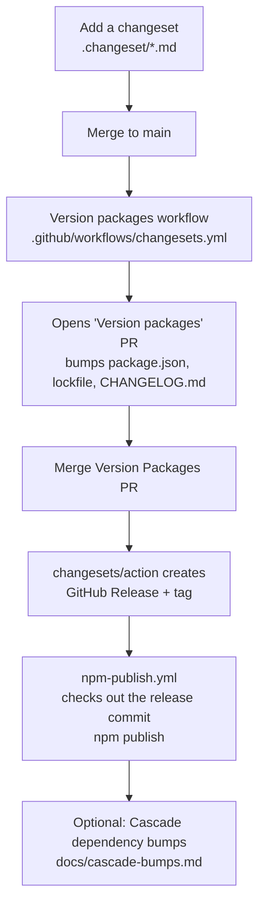

# Changesets release workflow

How a version of `@llazyemail/generate-template` is decided, tagged, and published.

**Ground rule:** the version in `package.json` is the only version `npm publish` uses. The GitHub Release tag must be created from a commit where that version already matches. Changesets is the tool that keeps them in sync. Do not hand-edit `package.json` `version` or `CHANGELOG.md`, and do not create a GitHub Release by hand before the Version Packages PR is merged.

## Why this exists

A manual GitHub Release (`v1.8.0`) that points at a commit whose `package.json` still says `1.7.1` makes the publish job try to publish `1.7.1` again and fail. The workflows below exist so the tag and the package version always move together.

## The flow



| Step | What happens | Who owns it |
| ---- | ------------ | ----------- |
| 1. Changeset | A markdown file in `.changeset/` declares the bump (`patch` / `minor` / `major`) and the user-facing summary. | You (local or UI) |
| 2. Merge | The file lands on `main`. | You |
| 3. Version PR | On push to `main`, **Version packages** runs `changesets/action`. If pending changesets exist, it opens a "Version packages" PR that runs `changeset version`. | `.github/workflows/changesets.yml` |
| 4. Merge Version PR | Merging that PR updates `package.json`, `package-lock.json`, and `CHANGELOG.md`, then `changesets/action` creates the GitHub Release (`create-github-releases: true`). | You + changesets/action |
| 5. Publish | **Publish to GitHub Packages** is triggered by `release: published`. It checks out that commit, runs the full gate, and `npm publish`es. | `.github/workflows/npm-publish.yml` |
| 6. Cascade (optional) | After publish, run **Cascade dependency bumps** to open update PRs in consumer repos. | `.github/workflows/cascade-bumps.yml` |

## How to add a changeset

### From the Actions UI (no local clone)

1. **Actions → Add changeset → Run workflow**.
2. Choose `bump` (`patch`, `minor`, or `major`) and write a `summary`.
3. The workflow writes `.changeset/<id>.md`, commits it, and opens a PR.
4. Merge that PR. The Version packages workflow then opens the Version Packages PR.

The workflow does **not** edit `package.json` or publish. It only creates the intent file. See `.github/workflows/add-changeset.yml`.

### Locally

```bash
npx changeset
```

Pick the bump type, describe the change, and commit the generated `.changeset/*.md` file on your PR (or push it to `main`). Same downstream path as the UI.

## What the Version packages workflow does

`.github/workflows/changesets.yml` runs on every push to `main`.

- If there are pending changesets → opens (or updates) the **Version packages** PR. That PR runs `npm run version-packages` (`changeset version`), which:
  - bumps `package.json` `version`
  - updates `package-lock.json`
  - prepends the entries to `CHANGELOG.md`
  - deletes the consumed `.changeset/*.md` files
- If the Version Packages PR has just been merged (no pending changesets left) → creates the GitHub Release and tag via `create-github-releases: true`.

It does not itself publish to GitHub Packages. Publishing is a separate workflow so the publish job always runs against the tagged commit.

## What the publish workflow does

`.github/workflows/npm-publish.yml` runs on `release: published` (and can be dispatched for a dry run).

1. Checks out the release commit (`fetch-depth: 1`).
2. `npm ci`, typecheck, lint, build, coverage, `npm pack --dry-run`.
3. `chmod +x` the CLI bins.
4. `npm publish` to GitHub Packages (`https://npm.pkg.github.com`), authenticated with `GITHUB_TOKEN`.

`npm publish` reads the version from the checked-out `package.json`. That is why the tag must point at the commit produced by the Version Packages PR.

There is also a `prepublishOnly` script in `package.json` that re-runs tests, build, and the bin chmod as a safety net.

## What not to do

- Do not create a GitHub Release from the Releases UI while `package.json` is still on the previous version. The publish job will try to republish the old version and fail.
- Do not hand-edit `package.json` `version` or `CHANGELOG.md` on `main` to "catch up" a release. Those files are owned by the Version Packages PR.
- Do not expect the release tag to override the package version. The tag is a pointer; the package version is data in the commit.

## After publish

Once the package is on GitHub Packages, you can fan the new version out to consumers with the cascade workflow. That is documented separately: [cascade-bumps.md](cascade-bumps.md).

---

See also: [architecture.md](architecture.md) (release bullet), [recipes.md](recipes.md) (Release recipe), [AGENTS.md](../AGENTS.md).
