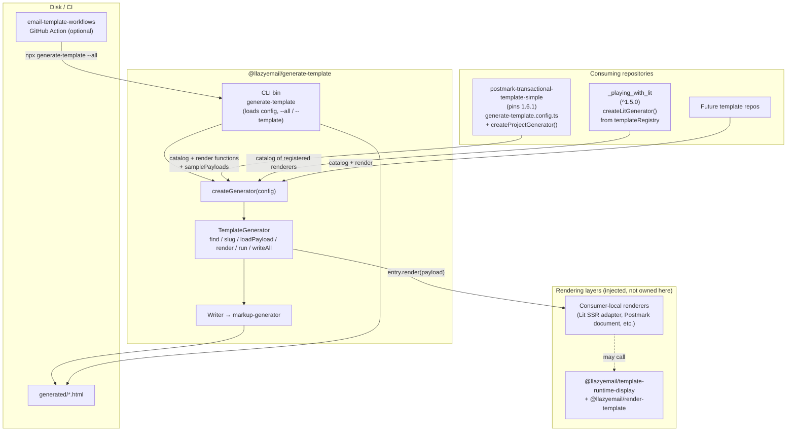

# Organization Schema — How `@llazyemail/generate-template` is used in LLazyEmail

This document shows where the package sits in the LLazyEmail organization and how sibling repositories consume it.  
Read this when you need the big picture (human or AI agent). Ground truth for behavior remains `src/`, contracts live in `AGENTS.md`, and detailed flows are in `docs/architecture.md`.

## Role in the ecosystem

`@llazyemail/generate-template` is the **generation / catalog / write** layer.

- It owns: catalog lookup, payload resolution, the `run` / `writeAll` contract, and disk writes (via `markup-generator`).
- It does **not** own: template content, part/compose rendering, or email shell fragments.
- Consumers inject their own `render` functions (Lit, React, plain functions, etc.).

Related packages (do not reimplement their responsibilities):

| Package | Owns |
| --- | --- |
| `@llazyemail/generate-template` | Catalog, payload resolution, `run`/`writeAll`, disk writes |
| `@llazyemail/render-template` | Low-level deterministic part/compose renderer (string parts only) |
| `@llazyemail/template-runtime-display` | Email shell fragments + runtime that builds on `render-template` |
| `markup-generator` | File writing primitives (`writeGeneratedFile`, `writeGeneratedEmail`, etc.) |

## Organization usage diagram



## Concrete consumers

### 1. `postmark-transactional-template-simple`

- Pins `@llazyemail/generate-template@1.6.1` exactly.
- `generate-template.config.ts` re-exports `createProjectGenerator` from `scripts/create-project-generator.ts`.
- The generator builds a catalog from the template manifest (`ids`, `file`, `exportName`, `render`) and attaches `samplePayloads` from the registry.
- CLI usage: `npm run generate:template -- --template=PasswordResetEmail --out=generated/...` or `--all`.
- Also uses the assert helpers (`assertGenerated`, etc.).

### 2. `_playing_with_lit`

- Depends on `^1.5.0`.
- `src/generation/preferred-generator.ts` builds a catalog from the existing `templateRegistry`.
- Each entry’s `render` calls the registered Lit renderer (which already goes through the local Lit-to-string adapter) and finalizes HTML.
- Preferred path: `createLitGenerator()` then `generate.run({ templateId, payload, write })`.
- Local `BuildPipeline`-style classes that reimplement catalog + payload + write are considered duplication.

### 3. Other / future

- Any new template repository should follow the same pattern: supply a catalog of `ids` + `render` (and optional sample payloads), then call `createGenerator` + `run` / `writeAll`.
- The GitHub Action in `email-template-workflows` can invoke the CLI (`npx generate-template --all --out=generated`) in any consumer.

## Typical consumer integration pattern

```ts
// generate-template.config.ts (or package.json "generateTemplate")
export { createProjectGenerator } from './scripts/create-project-generator.js';

// scripts/create-project-generator.ts
import { createGenerator } from '@llazyemail/generate-template';
import { templates, lookupKeys, templateData } from '../src/...';

export function createProjectGenerator() {
  const catalog = templates.map((t) => ({
    ids: lookupKeys(t),
    render: t.render,          // or a thin wrapper around your renderer
    // file / exportName only if you opt into allowFileTemplates
  }));

  const samplePayloads = { /* id → payload */ };

  return createGenerator({
    root: process.cwd(),
    catalog,
    samplePayloads,
    outDir: 'generated',
    reviveDates: true,         // when you need Date objects in payloads
  });
}
```

Then:

```bash
npx generate-template --list
npx generate-template --all --out=generated
npx generate-template --template=welcome --data=./payload.json
```

Or programmatically:

```ts
const generate = createProjectGenerator();
const result = await generate.run({
  templateId: 'welcome',
  payload: { name: 'Alex' },
  write: { out: 'generated/welcome.html' },
});
```

## Key contracts (summary)

1. `createGenerator` is the only factory.
2. `run({ write })` renders exactly once; `write` only controls persistence.
3. All disk writes go through `src/persist` → `markup-generator`.
4. Lookup is case-insensitive over all `ids`; slug = first id, trailing `Email` stripped, camelCase → kebab-case.
5. Failures are `GenerateTemplateError` with a stable `code`.
6. Prefer injected `render` functions over file templates (`allowFileTemplates` is opt-in).

## Where to go next

| You want to… | Read |
| --- | --- |
| Understand internal flows & resolution orders | `docs/architecture.md` |
| Change behavior safely | `AGENTS.md` (task router + contracts) + `docs/recipes.md` |
| Migrate a sibling repo | `MIGRATION.md` |
| See a live proof | `sandbox/` + `npm run sandbox` |
| Consumer-facing API | `README.md` |

---

*Last updated for the organization schema. Keep this file in sync when a new major consumer appears or the package boundaries change.*
